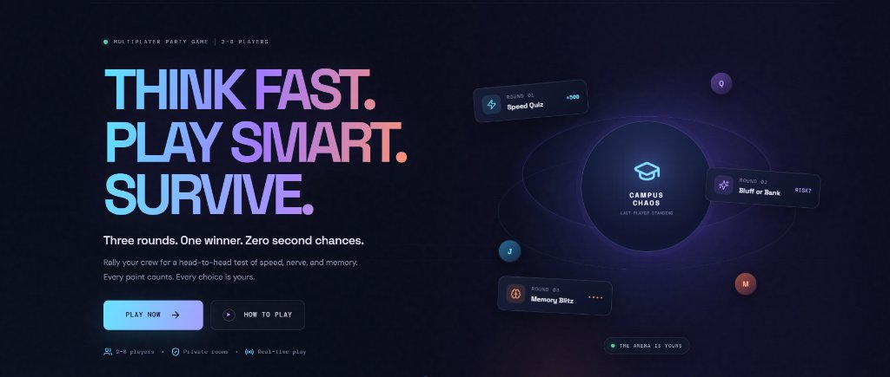

# Campus Chaos — Last Player Standing

<p align="center">
  
</p>

<p align="center">
  <strong>THINK FAST. PLAY SMART. SURVIVE.</strong><br>
  <em>Three rounds. One winner. Zero second chances.</em>
</p>

<p align="center">
  
  
  
  
  
</p>

---

## 🎮 About Campus Chaos

**Campus Chaos** is a fast-paced, real-time multiplayer party game designed for **2 to 8 players**. Rally your crew for an intense head-to-head test of speed, nerve, and memory. Every point counts, and every choice matters.

Play seamlessly across mobile and desktop browsers with instant private room codes—no downloads or logins required.

---

## 🕹️ Game Rounds

Campus Chaos challenges players across three distinct mini-games:

| Round | Mini-Game | Description | Scoring |
|---|---|---|---|
| **01** | **⚡ Speed Quiz** | 5 rapid-fire questions (15 seconds each). Fast responses score maximum points. | Correct: **+500 base** + speed bonus up to **+500**. Wrong/Timeout: **0**. |
| **02** | **✨ Bluff or Bank** | A high-stakes psychology test. Play safe or risk it all. | **BANK**: Safe **+300**.<br>**RISK**: **+800** if fewer players chose RISK than BANK; otherwise **−400** penalty! |
| **03** | **🧠 Memory Blitz** | 3 escalating sequence tests (4, 6, and 8 items displayed for 1s each). | **+200** per correct position + **+500** bonus for a perfect sequence. |

> **Tiebreaker Rules:** Total score determines the winner. If tied, Memory points break the tie, followed by Quiz points. Remaining ties share the victory!

---

## 🛠️ Tech Stack

- **Frontend:** React 18, TypeScript, Vite, Responsive CSS
- **Backend Serverless:** Netlify Functions (ESM / Node.js)
- **Room State & Persistence:** Netlify Blobs (distributed room state engine)
- **Testing:** Integration & unit test suites with custom match simulations

---

## 🚀 Getting Started

### Prerequisites

- [Node.js](https://nodejs.org/) (v20 or newer recommended)
- [Netlify CLI](https://docs.netlify.com/cli/get-started/) (`npm install -g netlify-cli` optional for dev environment)

### Installation

1. **Clone the repository:**
   ```bash
   git clone https://github.com/SAIVINAY983/Campus-Chaos-.git
   cd Campus-Chaos-
   ```

2. **Install dependencies:**
   ```bash
   npm install
   ```

3. **Run locally with Netlify Dev:**
   ```bash
   npm run netlify:dev
   ```
   *Netlify Dev launches the local app and provides an isolated local Blobs sandbox.*

4. Open the local URL in your browser, create a room, and share the code with friends or open in a second browser window to test multiplayer!

> **Tip for testing:** Set `CAMPUS_CHAOS_TIMER_SCALE=0.5` before running `npm run netlify:dev` to run timer intervals at double speed during local testing.

---

## 📦 Scripts

- `npm run netlify:dev` — Start the local development server with Netlify Functions and Blobs support.
- `npm run build` — Compile server functions, run TypeScript type check, and bundle production assets to `dist/`.
- `npm run test` — Run rule and scoring unit tests.
- `npm run test:integration` — Run full two-player, three-round integration tests against the local server.

---

## 🌐 Deployment to Netlify

This project is configured out-of-the-box for Netlify:

1. Connect your repository to **Netlify** or use `netlify deploy`.
2. Netlify reads [`netlify.toml`](./netlify.toml) automatically:
   - **Build Command:** `npm run build`
   - **Publish Directory:** `dist`
   - **Functions Directory:** `netlify/functions`
3. Ensure **Netlify Blobs** is enabled on your Netlify team/site for real-time state synchronization.

---

## 📄 License

This project is licensed under the [MIT License](LICENSE).
